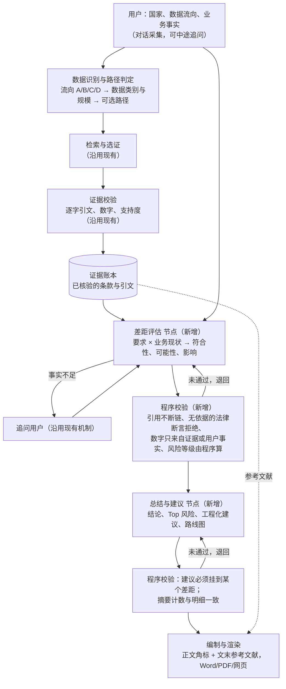
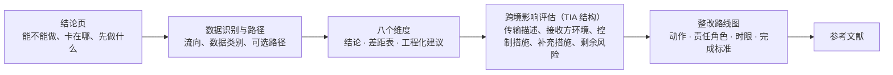
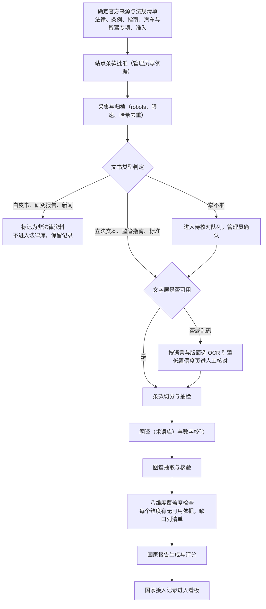
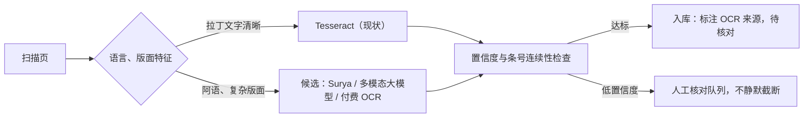
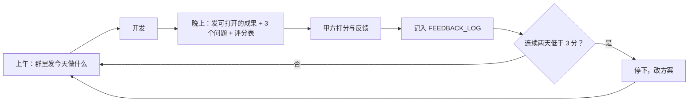
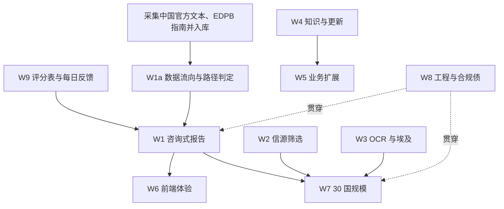

# 平台缺口改造总计划（对照 2026-10-27 甲方会议）

本文把会议要求、原始需求（30 国）和我们读完代码后发现的缺口放在一张表里，给出改造方案、流程图、顺序和验收方式。
逐日安排见 [REMEDIATION_PLAN_V2_DAILY_20261027.md](REMEDIATION_PLAN_V2_DAILY_20261027.md)，报告结构细节见 [REPORT_REDESIGN_PLAN_20261027.md](REPORT_REDESIGN_PLAN_20261027.md)。三份文档有出入时，以本文为准。

> 依据说明：代码缺口来自对源码的静态阅读，没有逐项运行验证；标“未见”的是在读过的范围内没找到，不等于一定没有，改造前先复核。

---

## 1. 会议要求逐条对照

| # | 会议要求 | 平台现状 | 缺口 | 对应改造 |
|---|---|---|---|---|
| M1 | 报告要有分析：差距、风险、工程化建议，法条只做引用 | 每维度输出“引用条款的义务转述”，建议是“核对并落实：”加原文，摘要是模板句 | **核心缺口** | W1 |
| M2 | 报告加总结模块，提高可读性 | 无 | 缺 | W1 |
| M3 | 法律库只收法律，不收白皮书、咨询报告 | 相关性判断只排除表格类，其余默认收录 | 缺文书类型判定 | W2 |
| M4 | 非英语 OCR 要达标（阿语、俄语、葡语等） | 只装 eng、ara、fra；每份最多 OCR 40 页，超出静默丢弃；埃及原文缺口 6 题 | 引擎、语言、截断、人工核对 | W3 |
| M5 | 埃及个人数据保护法及实施条例要完整获取 | 未完整获取 | 重采加重 OCR | W3 |
| M6 | 测试付费 OCR 并结合大模型 | 无评测，无可插拔引擎 | 评测集加适配器 | W3 |
| M7 | 找行业最佳实践样本，倒推报告格式 | 无样本 | 样本库加评分表 | W1、W9 |
| M8 | 每周二会前汇报下阶段目标，随出随发 PRD 和原型 | 无固定节奏 | 流程 | W9 |
| M9 | 稳定后规划跨国报告导出 | 单国报告 | 后置 | W7 |
| M10 | 保持可视化的协作过程、失败原因、模型参数 | 已有（Agent Studio） | 用户端只有阶段勾选 | W6 |

---

## 2. 原始需求对照下的其余缺口

| 编号 | 缺口 | 现状证据 | 对应改造 |
|---|---|---|---|
| G1 | 30 国覆盖（现 5 国 81 份文档、2,744 条款） | 每国靠人工调研和调试，国家名单与 450/300 条计数口径未定 | W7 |
| G2 | 8 类合规文件无实现 | 代码里的文档类型只是法规分类 | W5 |
| G3 | 图谱属性 8 项，需求 12 项 | `violation_level` 无填充逻辑，多项恒“待核查” | W4 |
| G4 | 无条款级版本对比 | 只有新版本后旧条款标过期 | W4 |
| G5 | 审计日志不完整，删除任务会级联删报告 | 缺登录、导出、编辑统一日志 | W8 |
| G6 | 72 小时联动偏弱 | 站点默认 7 天抓一次；手工上传不产生变更记录；联动只到提醒，不自动重分析；仅站内通知 | W4 |
| G7 | 订阅、批量、消息中心 | 订阅过滤与批量操作在读过的范围内未见 | W5 |
| G8 | 准入模块、舆情分级 | 未见实现 | W5（后置） |
| G9 | 人工金标为 0；召回率依赖默认关闭的 semantic_planning | 评测 32 题，人工复核 0/32 | W9 |
| G10 | 写死五国的硬编码违反 `AGENTS.md` | 采集发现、绑定、命令行、对话槽位、抽取种子 | W8 |
| G11 | 采集稳定性 | 站点租约 30 分钟可能超时被重复领取；robots 的 Crawl-delay 未用 | W2、W8 |
| G12 | 分析任务进程内运行，重启丢任务 | 内存 asyncio | W8 |
| G13 | 同一法规多份文本，有效状态全是“未核对” | 例：PDPA 在库里有两份 | W2 |
| G14 | 管理端无通知；用户端法规中心筛选弱；质量视图无问题项清单 | 前端阅读结果 | W6 |
| G15 | 部署与运维 | 无 HSTS、限流、自动备份；容量未验证；文档版本滞后 | W8 |
| G16 | 评审记录里 `review-points/import` 缺律所回复时用暂拟口径并保持“已确认” | 知识模块阅读 | W8 |

---

## 3. 目标形态

### 3.1 报告生成：从“找法条并列出”到“证据账本加咨询顾问”

要点：
- **证据账本不直接展示**，只通过角标和文末参考文献出现；现有的校验和复核标注全部保留。
- **风险等级由程序按“可能性×影响”算**，模型只给两个因子和理由。
- **三类断言分开管**：法律事实（必须带证据）、业务推论（要同时引用业务事实和证据）、建议（必须挂到差距，标注“非法律意见”）。
- 新节点放进 Agent Studio 的版本化工作流配置，提示词和模型可激活、可回滚。

### 3.2 报告章节（用户读到的样子）

工程化建议按四类写：车端（本地处理优先、摄像头与定位最小化）、数据架构（出境前脱敏或匿名化、分级、保留矩阵）、云端（访问控制、密钥、日志）、组织（协议、流程、演练）。

### 3.3 国家接入流水线（为 30 国复用）

### 3.4 OCR 路由与评测

选型靠自建评测集决定，不凭他人数据：从埃及、突尼斯、摩洛哥扫描件抽 30 页，人工校对出标准文本，比较字符错误率、条号保留率、数字与日期正确率、成本、耗时。付费服务外发前要走 `LLM_DATA_EGRESS` 评审。

### 3.5 每日反馈闭环

---

## 4. 工作包

优先级：P0 = 直接影响甲方满意度，必须先做；P1 = 达成需求的必要项；P2 = 后置，按甲方确认的范围推进。

| 编号 | 工作包 | 内容 | 主要改动位置 | 优先级 |
|---|---|---|---|---|
| W1 | 咨询式报告 | 差距评估、总结建议两个节点；程序校验；新报告 Schema；参考文献渲染；Word/PDF 版式；用户端报告页（摘要置顶、差距表、角标弹窗） | `analysis/pipeline.py`、`workflow_engine.py`、`prompts.py`、`report_exporter.py`、`pdf_renderer.py`、`ChatAnalysis.vue`；迁移 0024 | P0 |
| W1a | 数据流向与路径判定 | 对话增加数据流向事实；路径规则取自入库的官方原文，缺失标“需补充” | `chat.py`、新节点 | P0 |
| W2 | 信源筛选 | 文书类型判定（立法、指南、标准、非法律资料、表格）；低置信度进待核对；存量文档只重分类并出报告，不删除；站点登记可收录类型；PDPA 等多份文本的现行版本标记 | `ingestion/pipeline.py` 的相关性判断、`sources` | P0 |
| W3 | OCR 与埃及 | 评测集；引擎适配器；取消 40 页静默截断，改分批并记录事件；补语言包（按评测结果决定俄语、葡语等）；重采埃及个人数据保护法与实施条例；低置信度页人工核对 | `ingestion/ocr.py`、`Dockerfile` | P0 |
| W4 | 知识与更新 | 属性补到 12 项；条款级版本对比接口与界面；手工上传纳入变更记录；监测频率可配置；联动到“影响项 → 自动重分析建议” | `knowledge/`、`updates/service.py`、`Documents.vue` | P1 |
| W5 | 业务扩展 | 8 类合规文件（先确认清单）；订阅、批量、消息中心；准入模块；舆情分级 | 新模块，复用八维流水线与证据校验 | P1～P2 |
| W6 | 前端体验 | 用户端任务时间线；法规中心多维筛选；质量视图问题项可点开定位；任意两版对比并高亮；管理端通知 | `apps/web-user`、`apps/web-admin` | P1 |
| W7 | 30 国规模 | 国家接入流水线固化；覆盖度看板；批量生成与容量测试；分批接入；计数口径和名单确认 | `source_sites.json`、`cli.py`、看板 | P1 |
| W8 | 工程与合规债 | 去掉写死五国的硬编码；统一用户操作审计日志；任务改为保留历史不级联删；任务改为可恢复执行；租约和 robots Crawl-delay；`review-points/import` 补漏洞；HSTS、限流、备份；CI 增加端到端测试；文档版本同步 | 多处 | P1 |
| W9 | 质量与沟通 | 行业样本库；专家评分表；32 题基线对照；人工金标；每日反馈与每周二会前汇报；内部 PRD 与原型随出随发 | `docs/product/prd/` | P0 |

---

## 5. 依赖与顺序

关键前提：
- **中国出境规则和 EDPB 指南不在库里。** 没有入库就不能被报告引用。采集要遵守站点条款，必要时手工上传官方文件。在此之前，路径判定只能写框架，不能写具体门槛。
- **W7 之前必须由甲方确认**：30 国最终名单、“450 条制度、300 条标准”的计数单位、8 类合规文件的具体清单。

---

## 6. 时间安排（概要，逐日见 V2 计划）

| 时段 | 重点 | 当期可见成果 |
|---|---|---|
| 10-28 ～ 11-02 | 对齐报告形态：重写样稿；场景矩阵；OCR 与信源评测集；官方文本采集清单 | 甲方认可的样稿和一页验收标准 |
| 11-03 ～ 11-14 | W1 开发：Schema 与渲染、差距评估、程序校验、总结建议；11-11 周会演示新加坡系统生成版；W2、W3 并行 | 新加坡系统生成的咨询式报告；误收清单；OCR 对比表 |
| 11-17 ～ 11-21 | W7：五国套用新框架；覆盖度看板；第二批国家接入；W4、W6 | 覆盖度看板；多国报告 |
| 11-24 ～ 11-27 | 联合测试：引用正确性、不编造、导出、批量耗时与并发 | 测试报告与修复 |
| 11-28 ～ 11-30 | 冻结、部署、文档与培训；交付已完成国家清单和其余国家接入进度 | 交付包 |

---

## 7. 验收标准

| 范围 | 标准 | 测量方式 |
|---|---|---|
| 报告可读性 | 甲方评分表整体连续三天不低于 4 分；任一项连续两天不超过 2 分则停下改方案 | 每日评分 |
| 引用 | 正文每个角标都对应参考文献；每条参考文献至少被引用一次；无依据的法律断言为 0 | 程序校验加抽检 |
| 建议 | 每条建议都挂到差距，并含责任角色、时限、完成标准 | 程序校验 |
| 一致性 | 摘要计数与明细一致 | 程序校验 |
| 对照基线 | 同一批 32 题，改造前后的召回、引文通过率并列展示，不隐藏退步 | 评测报告 |
| OCR | 埃及评测集的字符错误率、条号保留率、数字日期正确率达到与甲方约定的目标（目标值待与陈博士确定） | 评测集 |
| 信源 | 五国 81 份文档逐份抽检，输出误收、漏收清单 | 人工抽检 |
| 通用性 | 新增国家不改核心代码；回归测试覆盖跨国家、跨语言 | 测试 |

---

## 8. 风险（需在下次会议告知甲方）

1. **30 国时间风险**：5 周内全部做到“已核验、可交付”风险很高；计划按统一模板、可复用流水线、透明覆盖度分批交付。
2. **官方文本入库**：中国出境规则和 EDPB 指南能否按时入库，决定“路径判定”能否写实。
3. **人工法律复核**：由第三方完成，复核前所有报告都是机器草稿；人工金标目前为 0。
4. **模型推论**：咨询层可能推论过度；程序校验能拦断链、无依据断言和数字不符，拦不住法律判断错误，需要专家打分兜底。
5. **算力**：线上演示主机配置低，批量生成和并发未验证。
6. **外部开源项目**：只借鉴思路，使用前核对许可证和维护状态并实测。
7. **8 类合规文件、准入、舆情**：需要与甲方重新确认优先级，可能无法全部进入 11-30 交付。
