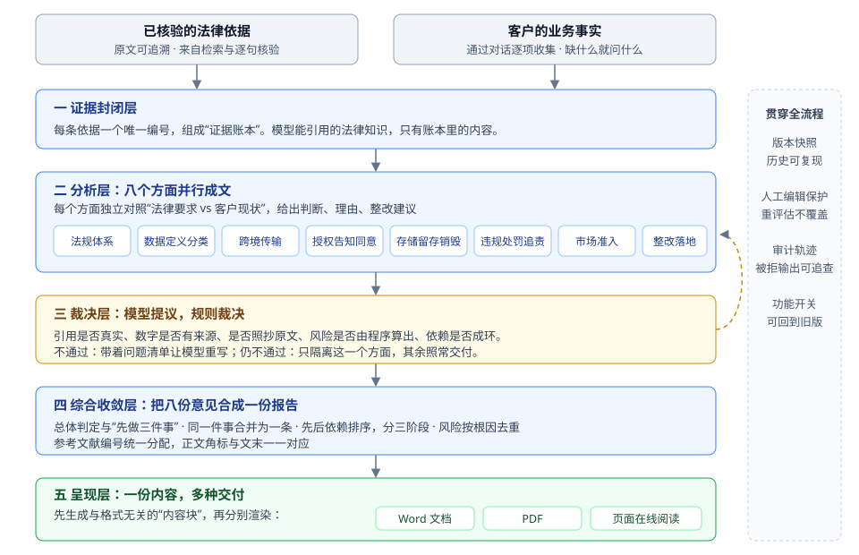

# 咨询式合规评估报告引擎：技术设计方案

> 范围：围绕“报告生成”这一项功能——从已核验的法律依据与客户业务事实，到一份可交付的咨询报告。
> 版本：2026-10-28

---

## 1. 设计目标

报告生成要同时满足三件事，而这三件事在技术上是互相拉扯的：

| 目标 | 读者的期待 | 技术上的张力 |
|---|---|---|
| **可信** | 每一句判断都经得起追问：依据是什么、数字哪来的 | 大模型擅长“写得像”，也擅长“写得像真的” |
| **可读** | 像顾问写的：先结论，再差距，再怎么办 | 可读性来自综合与取舍，而取舍恰恰是模型最容易失控的地方 |
| **可落地** | 能直接分给车端、云端、法务去执行 | 整改动作之间有先后、有重叠，必须结构化而不是堆文字 |

方案的核心判断是：**让模型做它擅长的事——理解、概括、组织语言；让程序做它擅长的事——核验、计算、排序、去重。** 两者之间用清晰的契约连接，而不是靠提示词“请你不要编造”。

---

## 2. 设计原则

**① 证据封闭。** 模型的“知识边界”由系统划定：它能引用的法律依据，只有经过原文核验的那一份清单。边界之外的内容，写不进报告。

**② 提议与裁决分离。** 模型负责提出判断，规则负责裁决是否采纳。凡是能用规则判断对错的事项（引用是否存在、数字是否有来源、依赖是否成环），一律不交给模型自查。

**③ 可复算。** 风险等级、整改阶段、执行顺序、参考文献编号——所有能由输入唯一确定的量，都由程序计算，保证同样的判断永远得到同样的结果，也便于审计。

**④ 缺口显式化。** 信息不够时，系统不猜，而是把“缺什么”变成一个明确的问题交还给客户；依据不够时，系统如实呈现“目前不能下结论”，而不是用流畅的文字掩盖空白。

**⑤ 内容与呈现分离。** 先产出与格式无关的结构化内容，再渲染成 Word、PDF 或页面，从根上保证多种交付物的一致。

---

## 3. 总体架构

- **证据封闭层**把上游已核验的法律结论整理成“证据账本”，同时承接客户业务事实。后续所有环节只能在这个封闭世界里写作。
- **分析层**把评估拆成八个方面并行成文，每个方面独立完成“法律要求 vs 客户现状”的对照。并行带来速度，也带来了跨方面的重复与冲突，这由综合层解决。
- **裁决层**是质量的闸门：模型的每一份输出都要通过规则裁决才能进入报告。不通过的，带着具体问题重写；仍不通过的，只隔离这一个方面，不拖累整份报告。
- **综合收敛层**把八份各自成文的意见收敛成一份报告：给出总体判定与最先要做的事，合并重复的建议，排出有先后依赖的路线图。
- **呈现层**把同一份内容渲染成不同的交付物。

报告结果以**不可变的版本快照**保存：历史报告在任何时候重新导出，得到的都是当时的内容；人工修改过的部分在重新评估时受保护；每一次被拒绝的模型输出都留有审计记录；整个咨询层可以由开关一键退回旧版。

---

## 4. 关键设计

### 4.1 证据封闭：让“有依据”成为结构，而不是承诺

**问题：** 要让报告读起来像咨询而不是罗列法条，就必须让模型自由概括；但自由概括与“每句话有依据”天然冲突。

**设计：** 不去约束模型“写什么”，而是约束它“能引用什么、怎么引用”。
- 每条依据在账本里有唯一编号。模型写每一条发现时，必须声明它依据的是哪几条编号；系统核对这些编号是否真实存在。
- 模型不直接写文献角标。参考文献的编号由系统在全文定稿之后统一分配，同一条款只占一个号。因此正文角标与文末文献**在构造上就是一一对应的**，不存在“角标对不上”这种问题。
- 对模型文字与依据原文做重合检测，逼迫它用自己的话概括，而不是把法条换个位置再抄一遍。

**效果：** 法律依据只出现在文末，作为可查证的参考文献；正文是咨询意见。读者既得到了可读性，又随时可以顺着编号追到原文。

### 4.2 提议—裁决闭环：用规则兜住模型的不确定性

**问题：** 大模型的输出天然带有随机性——偶尔漏字段、偶尔写错格式、偶尔冒出一个没有来源的数字。

**设计：** 模型的每一份输出都要经过一道“裁决”，裁决覆盖四类问题：

| 类别 | 裁决关心什么 |
|---|---|
| 真实性 | 引用的依据是否存在；引用的业务事实客户是否真的提供过 |
| 数字 | 每个数字能否在依据或客户事实里找到来源（支持“万”“million”等单位换算，但不凭空放行） |
| 原创性 | 是否大段照抄依据；是否含内部编号或系统术语 |
| 完整性 | 有差距是否给了评分；中高风险是否有对应建议；建议是否指向真实存在的差距 |

裁决不通过时，系统把**具体问题清单**反馈给模型，让它针对性地重写；仍不通过，则只隔离该方面（报告标记为“该方面暂未生成，可重新评估”），其余方面照常交付。

**取舍：** 对纯格式类的小毛病（多一个前缀、过量加粗、状态写成同义词），系统直接在入口处归一，不浪费一轮重写；对实质性的违规（凭空数字、无依据结论），**绝不放松**。这条线划得很清楚：格式问题宽容，事实问题严格。

### 4.3 判断可复算：风险、阶段与顺序都由程序给出

**风险等级。** 模型只回答两个可以讨论的问题——“发生的可能性”和“造成的影响”（各 1–5 分，并写出理由）；风险高低由 `可能性 × 影响` 的固定矩阵算出。同样的评分永远得到同样的等级，不会因为措辞而漂移。

**整改阶段。** 一条建议落在 30 天内、60 天内还是之后，由它的时限决定，不由模型“感觉”。

**执行顺序。** 模型只负责指出“做 B 之前必须先做 A”这样的依赖关系；系统把它们当作一张有向图来处理——剔除指向不存在事项的、自指的、与阶段矛盾的、构成环的依赖，再按阶段内的拓扑顺序排出路线图。读者看到的“先完成：×××”，一定是真正成立的前提。

### 4.4 缺口显式化：没有事实不下结论，没有依据不装懂

- **没有业务事实，就不判断。** 任何“达到 / 部分达到 / 未达到”的判断都必须挂靠客户亲口提供的事实；没有，就只能写“信息不足”，并明确写出需要客户补充什么。这些条目不会被拿去开整改药方，而是在报告里集中呈现为“需要你们补充”，同时成为下一轮对话要问的问题。
- **没有依据，就明说。** 某个方面确实没有可用的法律依据时（例如依据库里只有自动驾驶道路试验的条款，而客户做的是常规销售），报告直接写“该方面目前不能下结论”，并禁止出现“未发现问题”“已合规”这类把“没有依据”偷换成“没有问题”的说法。

这让报告的每一处空白都有名字，也让后续补充资料、重新评估有了明确的抓手。

### 4.5 跨方面一致性：并行生成，综合收敛

**问题：** 八个方面并行生成是为了速度，代价是同一件事（比如“签署跨境传输协议”）会被多个方面各提一遍，甚至换着措辞、放进不同类别、写成不同时限。

**设计：** 去重不押在单一手段上，而是**分四层逐级收敛**：

1. **生成时**：各方面只写本方面独有的内容；解释型方面里，“当地框架”和“对客户意味着什么”分工明确，不互相复述。
2. **语义层**：综合环节让模型识别“做完其中一条，另一条是不是也就做完了”的建议并成组（措辞、类别、时限都不影响判断），再由规则校验后合并；“先盘点、后签署”这种先后两步则不会被误并。
3. **结构层**：短标题相同、解决的差距重叠的建议，由程序合并，取更详细的做法、更紧的时限、差距取并集——任何一个差距都不会因为合并而失去建议覆盖。
4. **呈现层**：风险排序按“根因”去重（整改动作高度重合的风险只留最高的一条）；开头只列“先做什么”，具体做法只在路线图里写一次；客户现状只在附录登记表里逐条列出。

**设计取舍：** 不用“文字相似度”做去重。同一件事的两种写法，字面相似度往往很低，而两件不同的事反而可能措辞相近；所以语义判断交给模型，结构合并交给规则，各取所长。

### 4.6 内容与呈现分离：一份内容，多种交付

报告先被转换成一种与格式无关的中间表示——一串“内容块”（标题、判定、发现、表格、参考文献……）。Word、PDF、页面各自只负责把内容块画出来。

- 三种交付物的内容**必然一致**，不存在“PDF 里有、Word 里没有”。
- 呈现层可以针对各自介质做专门的版式工程，而不影响内容：Word 采用固定列宽与跨页重复表头、真正的标题样式与页码；PDF 采用随包字体与固定列宽。
- 单独导出某一个方面时，参考文献自动重新编号，附录只保留该方面，文件依然自洽。
- 导出文件按“日期_国家_业务_内容_版本”命名，同一份报告重复下载名称稳定，不同日期的报告一眼分得开。

### 4.7 版本、编辑与审计

- **快照不可变。** 每次评估生成新版本；历史版本的内容、编号、导出结果永远可以复现。
- **人工编辑受保护。** 用户在页面上修改过的方面或摘要被单独记录，重新评估时不会被覆盖；导出时优先使用人工修改后的文本。
- **审计可追溯。** 被裁决拒绝的输出、被合并的建议组、被剔除的依赖都有记录，既用于质量复盘，也为后续调整提示词和规则提供依据。
- **随时可退。** 咨询层由功能开关控制，关闭后回到旧版导出路径，两条路径并存。

---

## 5. 方案取舍

| 备选路线 | 优点 | 为什么没有选 |
|---|---|---|
| 检索后让模型直接写整篇报告 | 实现最简单 | 无法保证每句有依据；数字、风险高低、建议先后全凭模型“感觉”；出了问题无从定位 |
| 单次长提示一次性生成八个方面 | 内容天然连贯 | 篇幅与稳定性受限；一处出错整份重来；无法按方面独立重试与隔离 |
| 模板拼接，只由模型填空 | 版式稳定 | 读起来是“填表”而不是咨询；无法针对客户现状做综合与取舍 |
| 让模型自己给风险等级 | 省事 | 同一事实多次生成等级不同；无法解释、无法复核 |
| **本方案：证据封闭 + 并行成文 + 规则裁决 + 综合收敛** | 可信、可读、可落地兼得；任何一个环节可独立重试、替换、审计 | 工程量更大，但换来的是可控、可解释、可演进 |

---

## 6. 质量保障体系

三道防线，由内而外：

1. **规则层**：对每一条裁决规则、每一种计算（风险矩阵、数字来源与单位换算、依赖图与环检测、去重合并、参考文献编号与重编号）做独立的单元验证。
2. **契约层**：用刻意构造的“坏输出”——漏字段、格式漂移、引用不存在、凭空数字、照抄原文、过量加粗——验证系统要么修复、要么拒绝，从不放行。
3. **端到端层**：用真实模型在真实依据库上整单跑通，再把导出的 Word 用真实 Word 打开渲染、逐页检查版式与内容，确认表格、粗体、页码、文件名都符合预期。

真实模型输出具有随机性，因此系统把“偶发的不合格输出”当作常态来设计：每个方面可单独重试、单独隔离，整份报告可以降级交付并随时“重新评估”，而不是整份失败。

---

## 7. 可扩展性

- **国家与地区**：评估框架、裁决规则、版式都与具体国家无关；扩展一个国家，主要工作是依据入库与各方面适用性的确认。
- **文档类型**：证据账本、裁决闭环、内容块到多格式渲染这一整套机制是通用的；新增文档类型主要是定义新的内容结构与模板。
- **模型**：模型被封装在统一的调用契约之后，更换模型不触及业务规则；规则层与契约层的验证可直接用于新模型的验收。
- **评估方向**：出海与入境使用同一套机制，差别在依据库与措辞，而不在架构。

---

## 8. 演进路线

| 阶段 | 方向 |
|---|---|
| 近期 | 依据库覆盖度持续补齐（尤其是各国市场准入、官方指南类文件）；引用译文接入人工复核流程，复核状态可按需在报告中展示 |
| 中期 | 多国家批量接入；其余文档类型接入同一套证据与裁决框架；基于审计记录持续优化提示词与规则 |
| 长期 | 法规更新自动触发受影响方面的局部重评估；跨国别对比视图 |

