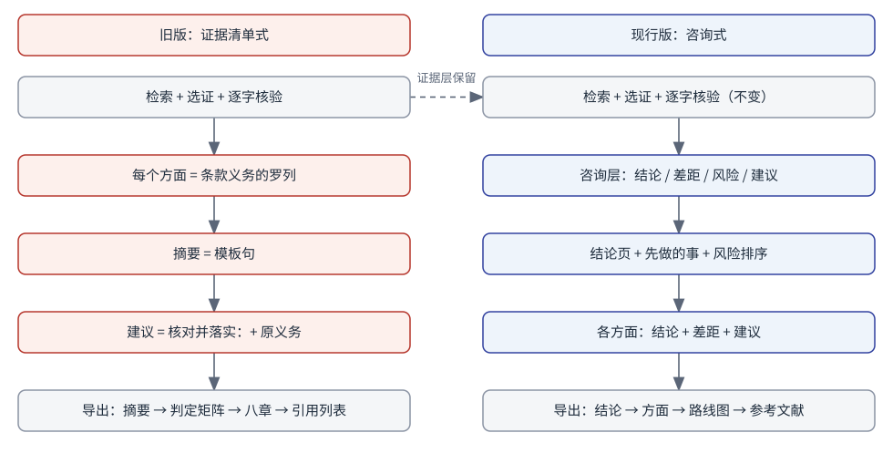
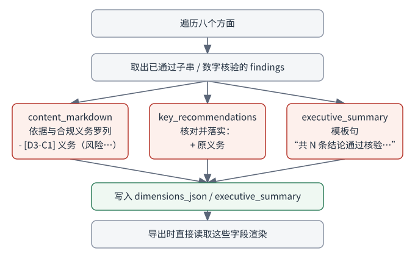
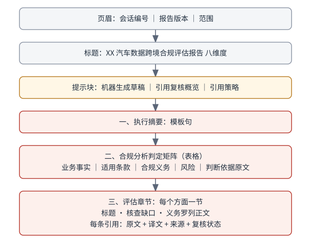
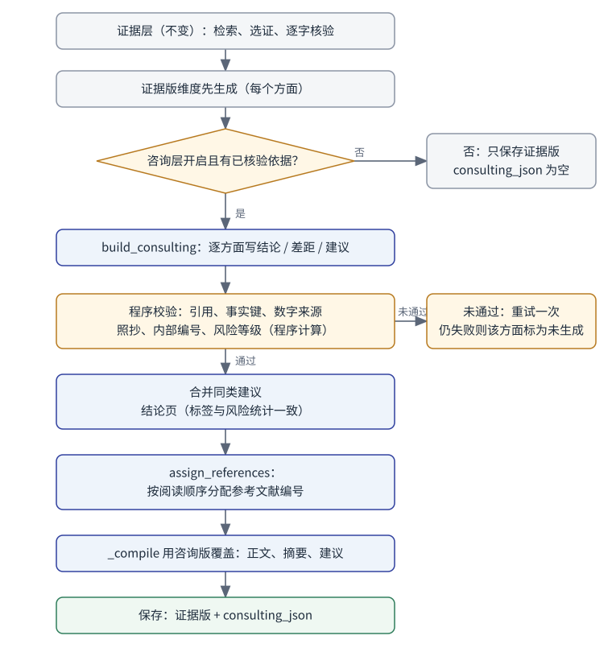
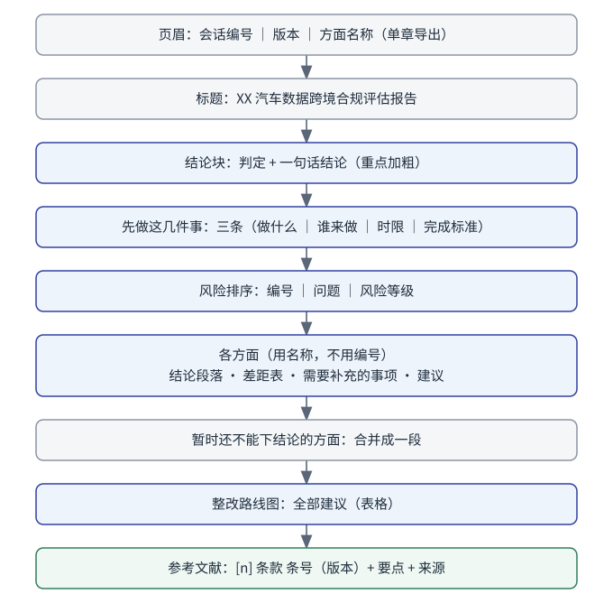
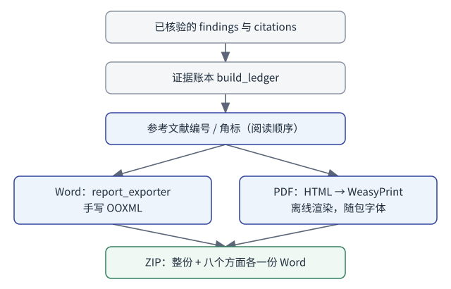

# 报告导出逻辑：旧版与现行版对比

本文说明两件事：

1. **旧版**（证据清单式）报告是怎么生成和导出的。
2. **现行版**（咨询式）报告是怎么生成和导出的，改了哪些地方。

代码依据：`backend/app/analysis/pipeline.py`（`_compile`、`_consulting_layer`）、`consulting.py`、`consulting_export.py`、`report_exporter.py`、`pdf_renderer.py`、`router.py`。

流程图为 SVG 图片，保存在 `report_export_figures/` 目录下。

---

## 1. 一张图看懂两者的区别

*图 1　左边是旧版，右边是现行版。证据层（检索、选证、逐字核验）两边都保留，变化在证据之上的那一层。*

| 维度 | 旧版 | 现行版 |
|---|---|---|
| 读者第一眼看到什么 | 模板摘要句（“共 N 条结论通过核验…”） | 判定结论 + 一句话 + 先做的三件事 |
| 法条在哪里 | 正文里大量出现（义务转述、引文） | 只以角标 `[n]` 出现在正文，**文末参考文献**列出 |
| 每个方面的内容 | 条款义务的罗列 + 引用列表 | 结论 2–4 句 + 差距表 + 建议 |
| 建议从哪来 | 把原义务换个说法（“核对并落实：…”） | 模型按差距写出的动作，带责任人、时限、完成标准 |
| 风险等级 | 模型给每条义务贴 HIGH/MEDIUM/LOW | 程序按“可能性 × 影响”计算 |
| 整份路线图 | 无 | 有，合并同类建议，按风险排序 |
| 证据校验 | 有 | **保留不变** |
| 内部编号（D1–D8、A-01） | 正文可见 | **不对业务人员展示**，改用方面名称 |
| 复核状态提示（待核对、机翻） | 正文可见 | 默认隐藏（开关 `report_review_notices` 可打开） |

---

## 2. 旧版导出逻辑

### 2.1 生成流程

*图 2　旧版在 `_compile` 里直接把义务罗列成正文，摘要是模板句，导出时只是把这些字段读出来渲染。*

### 2.2 导出版式（Word 和 PDF 结构一致）

*图 3　旧版导出的顺序：摘要、判定矩阵、八章逐章罗列，引用放在每章末尾。*

### 2.3 旧版的问题（为什么要改）

- **读不出结论。** 摘要是模板句，没有“能不能做”的判断。
- **满篇法条。** 每个方面的正文就是条款义务的转述，阅读体验像法条摘抄。
- **建议不是建议。** “核对并落实：”后面接的是原义务，没有责任人、时限和做法。
- **内部状态暴露给客户。** 页眉和正文里有“机器生成草稿”“待核对”等字样，还有 D1–D8 编号。

---

## 3. 现行版导出逻辑

### 3.1 生成流程

*图 4　现行版在证据版之后加一层咨询层。咨询层失败时，证据版报告照常保存，只是没有咨询版结构，不影响交付。*

关键点：**咨询层失败不影响交付。** 失败时保留证据版报告。

### 3.2 导出版式（咨询版）

*图 5　现行版导出的顺序：先给结论和三件先做的事，再是风险排序和各方面，路线图之后，法条只在最后的参考文献里出现。*

### 3.3 同一份数据在两种版式里的对照

| 内容 | 旧版呈现 | 现行版呈现 |
|---|---|---|
| 摘要 | “本报告针对【车型】在【国家】的业务场景…覆盖 5/8 个维度…” | “有条件可行：可做，但先补跨境协议与保护水平评估” |
| 方面正文 | “依据与合规义务：- [D3-C1] 须确保境外接收方提供可比保护（风险：HIGH）…” | 结论段落 + 差距表（现状、达到情况、风险、理由） |
| 建议 | “核对并落实：须确保境外接收方提供可比保护” | “与境外接收方签订数据传输协议并评估保护水平 · 法务负责人 · 30 天内 · 完成标准：协议签署并归档” |
| 法条 | 正文中的原文引用 | 正文角标 `[1][2]`，文末参考文献 |

---

## 4. 两种导出的共同部分（没有改）

*图 6　证据账本、参考文献编号、Word 与 PDF 的渲染方式、ZIP 打包，两个版本完全相同。*

- **Word** 由 `report_exporter.py` 手写 OOXML；**PDF** 由 `pdf_renderer.py` 生成 HTML 再离线渲染，字体有哈希校验。
- **导出缓存** 按内容哈希做键，报告内容变了缓存自动失效。
- **权限与租户**：导出接口只允许本企业的任务，与旧版相同。
- **引用被隔离的报告不能导出**，与旧版相同。

---

## 5. 用户端页面的变化

| 位置 | 旧版 | 现行版 |
|---|---|---|
| 报告卡片标题 | 八维度合规评估报告 | 合规评估报告 |
| 摘要 | 模板句 | 结论块（判定 + 一句话） |
| 方面列表 | 八个折叠面板，标题带 D1–D8 | 按方面名称展开，没有依据的方面合并 |
| 矩阵 | 默认展开 | 收起，作为“依据明细”供核对 |
| 修订入口 | 每章可编辑 | 每章可编辑；未改动的内容保留加粗 |
| 版本对比 | 按章对比 | 按章对比，去掉加粗标记后展示 |

---

## 6. 配置与开关

| 开关 | 作用 | 默认 |
|---|---|---|
| `consulting_enabled` | 是否生成咨询层；关闭则只出证据版 | 开 |
| `report_review_notices` | 是否在报告里显示复核状态、机器草稿等提示 | 关 |

---

## 7. 仍需注意的限制

- 咨询层的文字由模型生成，程序只能拦住断链、无依据的断言、数字来源不明、照抄和内部编号；**法律判断的正确性仍需人工专家复核**。
- 没有依据的方面不会硬写结论，这是有意的，也会让报告看起来“空”一块。
- 路线图目前是合并后的平铺表，还没有按“先后依赖”分阶段。
- 页眉和正文的提示默认隐藏，但**参考文献的复核状态也默认隐藏**；对外交付前，需要确认这是你们想要的。
